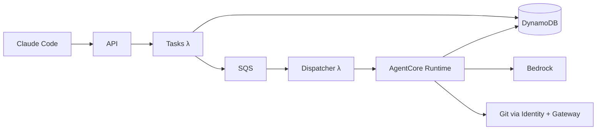

# AIPDLC remote coding agent — components & flow

## Components

```
┌─────────────────┐
│  Claude Code    │  MCP plugin (stdio) + AWS SigV4
│  (your laptop)  │
└────────┬────────┘
         │ HTTPS /tasks
         ▼
┌─────────────────────────────────────────────────────────────┐
│  Function URL →  Guardrail  →  Lambda (tasks)               │
│                     │              │                         │
│                     │              ├──► DynamoDB (Tasks)      │
│                     │              └──► SQS (queue)           │
│                     │                         │                │
│                     │                         ▼                │
│                     │              Lambda (dispatcher)         │
│                     │                         │                │
│  AgentCore Gateway ◄┼─────────────────────────┼──► (PR tools)   │
│  (GitHub API…)     │                         │                │
└────────────────────┼─────────────────────────┼────────────────┘
                     │                         │ Invoke runtime
                     │                         ▼
┌────────────────────┼─────────────────────────────────────────┐
│  VPC               │  AgentCore Runtime (one per fleet)       │
│                    │    └─ Harness: clone → AIPDLC → verify   │
│                    │              → push → open PR            │
│  Private: Bedrock, AgentCore, Gateway, ECR, Logs (endpoints) │
│  NAT: git clone/push over HTTPS                                │
└────────────────────┴─────────────────────────────────────────┘
         │
         ▼
┌─────────────────┐
│  GitHub / etc.  │  clone · push · pull request
└─────────────────┘
```

## Flow (one task)



| Step | What happens |
|------|----------------|
| 1 | Operator calls `submit_task` with `repositoryUrl` + prompt. |
| 2 | Guardrail screens prompt; task row written; message queued. |
| 3 | Dispatcher invokes the fleet runtime with the task payload. |
| 4 | Harness clones repo (Identity), runs AIPDLC loop (Bedrock), runs verification, pushes branch. |
| 5 | PR opened via Gateway; status and PR URL stored in DynamoDB. |
| 6 | Operator polls `get_task` from Claude Code. |

## CDK stacks (deploy order)

`Data` → `Gateway` → `Runtime` → `Api` (+ `Account` for Bedrock budget in us-east-1)