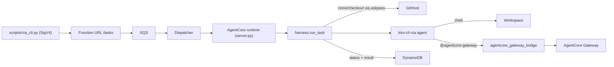

# Architecture

Components:

| Piece | Role |
|---|---|
| Task API | IAM-signed Lambda function URL: create, list, get, cancel tasks |
| Dispatcher | SQS → AgentCore `InvokeAgentRuntime` with task payload |
| Runtime | `coding_agent.server` off-thread harness |
| Kiro `rca` agent | `read` / `write` / `shell` + Gateway MCP |
| Gateway | OpenAPI targets (GitHub, Jira, Confluence, …) |
| Identity | Workload `rca_git_wl` + per-host credential providers |

Debug artefacts per task (under the runtime work dir): `kiro-stream.jsonl`,
`gateway-bridge.log`; CloudWatch log group `/aws/bedrock-agentcore/runtimes/...`.